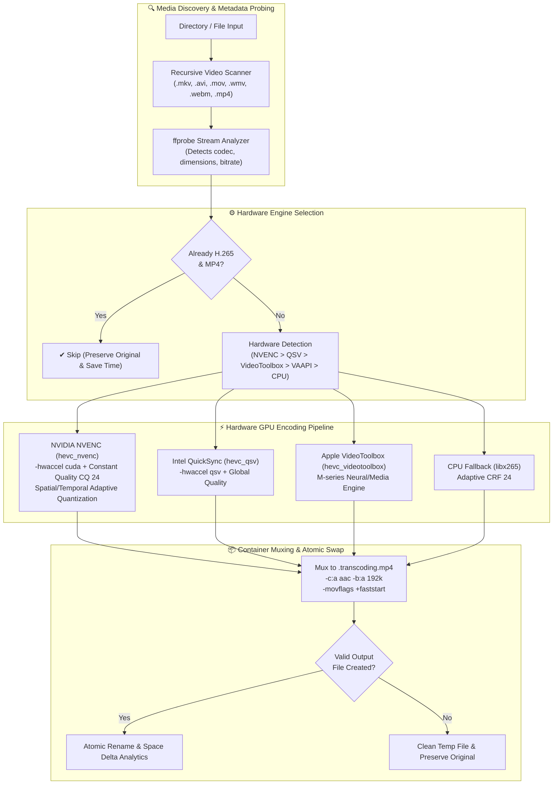

<div align="center">

# ⚡ GPU-Accelerated H.265 (HEVC) Media Transcoder

### High-Throughput Batch Video Transcoding Pipeline Powered by NVIDIA NVENC, Intel QSV, Apple VideoToolbox & FFmpeg
**Squeeze 50–70% of storage out of your media library while retaining visual fidelity and enabling instant browser Direct Play.**

<p align="center">
  
  
  
  
  
  
</p>

</div>

---

## 🚀 Why Hardware GPU Transcoding Matters

Converting large media libraries (MKV, AVI, MOV, WMV, WebM) on traditional CPU encoders (`libx264` / `libx265`) pins 100% of your CPU cores for hours or days, generates extreme heat, and throttles adjacent services. 

`ffmpeg_convert_h265_mp4` leverages dedicated silicon hardware encoding engines (**NVIDIA NVENC**, **Intel QuickSync**, **Apple VideoToolbox**, and **VAAPI**) to offload 98% of compute to your GPU, delivering **5x to 15x real-time speed** while dropping typical movie and TV episode file sizes by over half.

| Feature / Metric | Legacy CPU Transcoding (`libx265`) | GPU Acceleration (`hevc_nvenc` / QSV) |
| :--- | :--- | :--- |
| **Encoding Speed** | 0.4x – 1.2x (Slower than real-time) | **6.5x – 18.0x (Hundreds of FPS)** |
| **Host CPU Utilization** | 95% – 100% (All cores pinned) | **< 5% (GPU dedicated ASIC pipeline)** |
| **Average Space Savings** | 45% – 60% | **50% – 70% (Spatial/Temporal AQ)** |
| **Plex / Browser Streaming** | Stutters or forces server transcode | **Native Direct Play (FastStart MP4 + AAC)** |
| **Safety & Atomicity** | In-place file corruption on crash | **Atomic temp file swap + zero data loss** |
| **H.265 Smart Skip** | Re-encodes everything blindly | **Probes streams and skips compliant files** |

---

## 🏗️ Transcoding Engine Architecture



---

## ✨ Core Features

1. **Auto Hardware Acceleration Detection**:
   - Automatically probes your system for **NVIDIA NVENC** (`hevc_nvenc`), **Intel QSV** (`hevc_qsv`), **Apple Silicon VideoToolbox** (`hevc_videotoolbox`), or **Linux VAAPI** (`hevc_vaapi`).
   - Gracefully falls back to high-quality software CPU encoding (`libx265` / `libx264`) if no supported GPU encoder is detected.
2. **True H.265 (HEVC) + MP4 Output**:
   - Modernizes legacy codecs (H.264, MPEG-2, MPEG-4, VC-1, DivX, XviD, VP8/VP9) into universal HEVC.
   - Converts MKV, AVI, TS, and MOV containers into universal MP4 with `-movflags +faststart` for zero-buffer streaming in Plex, NovaFlix, web browsers, and mobile devices.
3. **Atomic File Safety Guarantee**:
   - Transcodes into a hidden staging file (`.filename.transcoding.mp4`).
   - Only replaces or updates the destination once FFmpeg exits with code `0` and verifies non-zero byte size. If canceled or interrupted, your original file remains 100% intact.
4. **Smart HEVC Skip**:
   - Automatically inspects streams using `ffprobe`. Files that are already high-efficiency H.265 in an MP4 container are skipped automatically, preventing redundant re-compression and generational quality loss.
5. **Live Space Savings & Telemetry**:
   - Computes real-time byte deltas per file and outputs a colorized summary report displaying total original footprint, compressed footprint, net storage saved (GB), and elapsed duration.
6. **Audio & Subtitle Compatibility**:
   - Automatically transcodes multi-channel audio to high-bitrate AAC (192kbps) for universal playback and preserves standard text subtitles (`mov_text`).

---

## ⚡ 1-Line Cross-Platform Installers & Packages

Install `transcode-media`, `ffmpeg-convert`, `transcode-gui` (Multi-GPU Studio), and `gpu-monitor` globally in seconds:

### 🪟 Windows (PowerShell, CMD & Standalone `.exe` Package)
**PowerShell (5.1 & 7+):**
```powershell
irm https://ffmpeg.ertechlab.com/install.ps1 | iex
```
**CMD / Windows Terminal (ExecutionPolicy Bypass):**
```cmd
powershell -NoProfile -ExecutionPolicy Bypass -Command "irm https://ffmpeg.ertechlab.com/install.ps1 | iex"
```
**Windows Setup Package (`.exe` GUI Wizard or Silent `/S`):**
- Direct Download: [`FFmpeg-Transcoder-Setup-x64.exe`](https://ffmpeg.ertechlab.com/downloads/FFmpeg-Transcoder-Setup-x64.exe) | [`FFmpeg-Transcoder-Windows-Portable.zip`](https://ffmpeg.ertechlab.com/downloads/FFmpeg-Transcoder-Windows-Portable.zip)
```powershell
irm https://ffmpeg.ertechlab.com/downloads/FFmpeg-Transcoder-Setup-x64.exe -OutFile "$env:TEMP\FFmpeg-Setup.exe"; Start-Process -Wait "$env:TEMP\FFmpeg-Setup.exe" -ArgumentList "/S"
```

### 🐧 Linux & 🍎 macOS (`curl` & `.deb` Package)
```bash
curl -fsSL https://ffmpeg.ertechlab.com/install.sh | bash
```
**Debian / Ubuntu / Proxmox `.deb` Package:**
```bash
curl -fsSL https://ffmpeg.ertechlab.com/downloads/ffmpeg-transcoder_2.0.0_all.deb -o /tmp/ffmpeg-transcoder.deb && sudo apt install -y /tmp/ffmpeg-transcoder.deb
```

### 🐍 Python Package (`pip` / `pipx`)
```bash
pip install https://ffmpeg.ertechlab.com/downloads/ffmpeg_h265_transcoder-2.0.0-py3-none-any.whl
```

> 📖 **Full Documentation, Checksums & Interactive Web Guide**: Visit [ffmpeg.ertechlab.com/install.html](https://ffmpeg.ertechlab.com/install.html).

---

## 🛠️ Manual Installation & Prerequisites

### 1. Requirements
- Python 3.9+
- **FFmpeg** and **FFprobe** installed with hardware encoder support.

### 2. Linux (Debian / Ubuntu / Proxmox)
```bash
# Standard install (includes NVENC support on modern Debian/Ubuntu)
sudo apt update && sudo apt install -y ffmpeg python3

# If using NVIDIA GPU, ensure drivers and CUDA are installed:
nvidia-smi
```

### 3. macOS (Apple Silicon / Intel)
```bash
brew install ffmpeg
```

### 4. Windows
Download FFmpeg from [gyan.dev](https://www.gyan.dev/ffmpeg/builds/) or install via WinGet / Scoop:
```powershell
winget install Gyan.FFmpeg
```

---

## 💻 Usage & CLI Options

### Interactive Mode
Run the script with no arguments to be prompted for a directory or file:
```bash
./transcode_media.py
```

### Direct CLI Commands

```bash
# 1. Transcode an entire media directory using auto hardware detection
python3 transcode_media.py /data/media/movies

# 2. Maximum Throughput: Run DUAL-ENGINE (GPU + CPU simultaneously) for faster batch conversions
python3 transcode_media.py /data/media/tv --both

# 3. Force dedicated GPU hardware transcoding (NVENC, QSV, VideoToolbox, VAAPI)
python3 transcode_media.py /data/media/movies --gpu

# 4. Force multi-threaded CPU software transcoding (libx265 with all cores)
python3 transcode_media.py /data/media/movies --cpu --cpu-threads 16

# 5. Customize the Level Progress Bar design (level, blocks, ascii)
python3 transcode_media.py /data/media/movies --bar-style level

# 6. Explicitly choose encoder and Constant Quality (CQ 20)
python3 transcode_media.py /data/media/tv --encoder hevc_nvenc --cq 20

# 7. Dry-run mode: scan and preview planned transcoding actions without writing files
python3 transcode_media.py /data/media/movies --dry-run

# 8. Automatically delete original .mkv/.avi files after successful transcode
python3 transcode_media.py /data/media/downloads --delete-original
```

### CLI Reference

| Parameter | Type | Default | Description |
| :--- | :--- | :--- | :--- |
| `path` | Positional | `None` (Interactive prompt) | Path to target media directory or individual video file. |
| `--mode` | Choice | `auto` | Transcoding acceleration mode: `gpu`, `cpu`, `both` (dual-engine parallel), or `auto`. |
| `--gpu` | Flag | `False` | Shorthand to force GPU hardware transcoding. |
| `--cpu` | Flag | `False` | Shorthand to force multi-threaded CPU software transcoding. |
| `--both` | Flag | `False` | Shorthand for Dual-Engine mode (concurrently runs GPU + CPU for maximum conversion speed). |
| `--bar-style` | Choice | `level` | Visual style of level progress bar: `level` (`▰▰▰▱▱`), `blocks` (`███░░`), or `ascii`. |
| `--encoder` | Choice | `auto` | Choose `auto`, `hevc_nvenc`, `hevc_qsv`, `hevc_vaapi`, `hevc_videotoolbox`, `hevc_amf`, `libx265`, `libx264`. |
| `--cq` | Integer | `24` | Constant Quality / CRF level (18 = near lossless, 24 = recommended balance, 28 = higher compression). |
| `--preset` | String | `p4` | Encoder speed preset (NVENC: `p1`-`p7`; CPU: `ultrafast`-`veryslow`). |
| `--cpu-threads` | Integer | `0` | Threads allocated for CPU encoding (0 = auto-detect all logical cores). |
| `--gpu-workers` | Integer | `1` | Number of parallel GPU worker threads in `--mode both`. |
| `--cpu-workers` | Integer | `1` | Number of parallel CPU worker threads in `--mode both`. |
| `--hwaccel` | Choice | `auto` | Hardware decoding acceleration API (`auto`, `cuda`, `qsv`, `vaapi`, `d3d11va`, `none`). |
| `--delete-original`| Flag | `False` | Deletes the input file when transcoding from MKV/AVI/MOV to MP4. |
| `--overwrite` | Flag | `False` | Overwrites existing output MP4 file if already present. |
| `--re-encode-hevc` | Flag | `False` | Forces re-encoding even if the file is already encoded in H.265. |
| `--dry-run` | Flag | `False` | Simulates the transcode pipeline and outputs estimated space savings. |

---

## 🎬 Interactive GUI Studio with Remote Computer & NAS Support

The suite features an interactive, high-performance GUI (`transcode_gui.py`):
```bash
python transcode_media.py --gui
# or on Windows: double-click Launch_Transcoder_GUI.bat
```

### Key GUI Highlights:
1. **Target Environment Selector**:
   - **Local Machine**: Automatically uses your local dual GPUs (NVIDIA NVENC, Intel UHD/Iris QSV, AMD AMF, CPU).
   - **Remote Computer / NAS (SSH)**: Connect to any remote server (e.g. Proxmox `192.168.40.31`, Media VM `192.168.0.19`, or TrueNAS `192.168.0.3`).
2. **Direct Remote NAS Execution (Zero Network Bottlenecks)**:
   - Encodes directly on the remote server's silicon against mounted NAS storage (e.g. `/data/media/tv-shows`, `/mnt/user/data/media`).
   - Does NOT transfer raw media files over your local network.
   - Automatically provisions and syncs the transcode worker scripts to `/tmp/` on the remote host.
3. **Smooth Graduated Level Progress Bars & Live Telemetry**:
   - 10-level graduated progress bar (`[LVL 1/10]` to `[LVL MAX]`).
   - Streams live speed multipliers (`⚡ 14.2x`), encoding FPS, bitrate, elapsed time, and dynamic ETA over the SSH channel directly into the GUI.
4. **Remote Directory Explorer & Queue Manager**:
   - 1-click scan for remote NAS directories and media candidates.
   - Smart skip for already-compliant H.265 files and lossless container preservation (`--container auto`).
   - Profile persistence (`~/.ffmpeg_gui_remote.json`) to remember your favorite homelab hosts.

---

## 📊 Real-Time Level Progress Bar & Telemetry

```text
==============================================================================
⚡ Batch Transcoding Queue: 14 media candidate(s) found
Hardware Strategy: Mode: BOTH | Engine: NVIDIA NVENC (GPU) (hevc_nvenc)
==============================================================================

⚡ Dual-Engine Parallel Acceleration Active!
  • Worker 1 (GPU): Dedicated ASIC (NVIDIA NVENC [RTX 3060])
  • Worker 2 (CPU): Multi-Threaded CPU (libx265 -threads 16)
  • Concurrent Queue: Dynamically dispatching 14 file(s) across both silicon blocks...

▶ Transcoding: Dune.Part.Two.2024.1080p.mkv [1/14]
  Source: H264 1920x1080 | 11.4 GB | 02:46:12
  Engine: NVIDIA NVENC (GPU) (CQ/CRF: 24) [Mode: BOTH]
  [Queue 1/14 | LVL 1/10] [GPU: hevc_nvenc] Level: [▰▰▰▰▰▰▰▰▰▰▰▰▱▱▱▱▱▱▱▱] 62.4% [LVL 7/10] ⚡ 14.8x | 355 fps | ETA: 04:15 | 01:43:42/02:46:12
  ✔ Complete: 11.4 GB ➔ 4.2 GB (+63.1%) in 04m 12s

▶ Transcoding: The.Matrix.1999.Remux.mkv [2/14]
  Source: VC1 1920x1080 | 18.2 GB | 02:16:00
  Engine: Multi-Threaded CPU (libx265 -threads 16) (CQ/CRF: 24) [Mode: BOTH]
  [Queue 2/14 | LVL 2/10] [CPU: libx265]   Level: [▰▰▰▰▰▰▰▰▱▱▱▱▱▱▱▱▱▱▱▱] 41.5% [LVL 5/10] ⚡ 2.4x  |  58 fps | ETA: 18:30 | 00:56:26/02:16:00
  ✔ Complete: 18.2 GB ➔ 6.1 GB (+66.4%) in 08m 45s

==============================================================================
✨ Transcoding Batch Summary
==============================================================================
 • Total Scanned:      14
 • Transcoded:         12
 • Skipped:            2
 • Failed:             0
 • Original Footprint: 84.6 GB
 • Modern Footprint:   31.2 GB
 • Space Savings:      53.4 GB (+63.1%)
 • Total Elapsed:      42m 18s
==============================================================================
```

---

## 🌐 Web Showcase Portal & K3s Kubernetes Cluster

This project includes a modern glassmorphic web portal and high-availability Kubernetes manifests deployed on the homelab K3s cluster:

- **Live Endpoints**:
  - Internal Cluster DNS: `http://ffmpeg.ertech.home`
  - Homelab Edge / Cloudflare / NPM: `https://ffmpeg.ertechlab.com`
  - NodePort Gateway: `http://192.168.0.81:30095`
- **Features in Portal**:
  - Interactive **Storage Savings Calculator** (model your library size and projected ROI)
  - Live **Benchmark Comparisons** (NVENC vs QSV vs VideoToolbox vs CPU)
  - Real-time **CLI Telemetry Simulation**
  - **1-Click Command Copying** for common transcoding workflows
- **Kubernetes Architecture**:
  - Multi-replica Nginx Alpine deployment (`tools` namespace)
  - Resilient shared NFS cluster storage (`/data/appdata/ffmpeg-website/html`)
  - Traefik ingress controller & Nginx Proxy Manager edge routing with wildcard SSL

Deploy to your own Kubernetes cluster in one step:
```bash
kubectl apply -f k8s/k8s-manifest.yaml
```

---

## 👤 Author & Open Source Portfolio

Crafted with ⚡ by **Efrain Rivas** ([@digdast](https://github.com/digdast)):
- 🎬 **[NovaFlix](https://github.com/digdast/novaflix)** — Sovereign Next-Gen Open Media Platform (4K HDR Direct Play & SyncPlay)
- 🛡️ **[AegisDNS](https://github.com/digdast/aegisdns)** — Recursive RFC 8484 DNS-over-HTTPS Resolver & 227k+ Threat Sinkhole
- ⚡ **[Pulsearr](https://github.com/digdast/pulsearr)** — Asynchronous Python Media PVR (Sonarr/Radarr Alternative)
- 🚀 **[Renamarr](https://github.com/digdast/renamarr)** — FileBot Alternative with Instant IMDb/TVMaze Matching & 1-Click Undo
- 🖥️ **[Proxmox Cluster Suite](https://github.com/digdast/proxmox-cluster-suite)** — 5-Node HA Proxmox Cluster Optimization & Live Dashboard
- 🌐 **[Live Resume](https://resume.ertechlab.com)** — Enterprise Cloud & Kubernetes Architecture Portfolio

---

## 📄 License
This project is licensed under the **MIT License**. Free for personal and commercial homelab automation.
